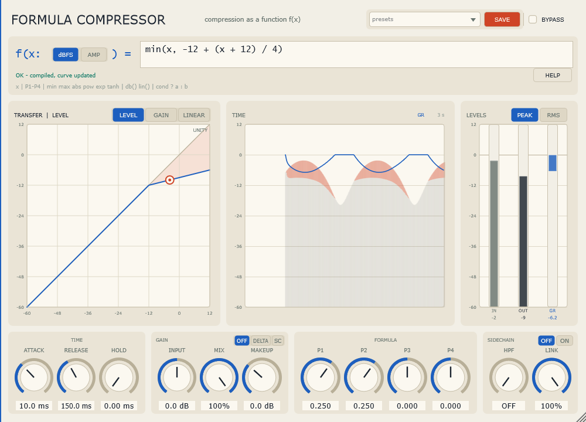

# Formula Compressor

[](https://github.com/Nejiwwkr/formula-compressor/actions/workflows/build.yml)
[](https://github.com/Nejiwwkr/formula-compressor/releases/latest)

**Write the compression curve.**

A normal compressor is a fixed transfer curve, usually `f(x) = min(x, ax + b)`.
Formula Compressor exposes the curve: type an expression for `f(x)`, or drive it
from the main input `x` and up to four external sidechains `s1`..`s4` in
`f(x, s1..s4, s)`, where `s` is their combined level. The result is a usable
dynamics processor, a multi-source modulation tool, and a small playground for
custom compression shapes.



## Download

Windows x64 builds are published on the
[Releases](https://github.com/Nejiwwkr/formula-compressor/releases/latest) page
as a zip with the VST3, the standalone application, install notes, and a
SHA-256 checksum. The binaries are not code-signed, so Windows SmartScreen may
warn about an unknown publisher.

## How it works

```text
Main input ── input trim ── x detector ─┐
                                        ├── f(x, s1..s4, s) ── gain ── mix / makeup ── monitor ── out
SC1 ─┐                                  │
SC2 ─┼── one HPF ── s1..s4 detectors ───┘
SC3 ─┤        s = linear sum of s1..s4
SC4 ─┘
```

- `x` is the main-input detector level.
- `s1`..`s4` are four independent external sidechain detector levels. The
  SIDECHAIN switch is only **Off / On**: when on, every aux bus the host enables
  feeds its own variable.
- `s` is the combined sidechain level: the linear sum of the four detectors,
  converted to the current domain (two -6 dBFS sidechains sum to 0 dBFS, not
  -12 dBFS).
- All detectors use the same Peak/RMS mode and Attack/Release/Hold; the four
  sidechains share one HPF frequency but keep independent filter and envelope
  state.
- `x`, `s1`..`s4` and `s` use the mode selected next to the formula box:

```text
AMP    x, s1..s4 and s are linear amplitudes; f(...) returns linear amplitude
       gain = f(...) / x

dBFS   x, s1..s4 and s are dBFS; f(...) returns dBFS
       gain dB = f(...) - x
```

The formula describes the *static* transfer, while the time constants describe
how fast the detectors reach it. It is not per-sample waveshaping, so there is
no aliasing and no added latency.

The formula is evaluated at the current sidechain levels: the curve view shows
the `f(x, s1..s4, s)` slice for the current values, and the readout next to the
formula shows the four buses and the total. With the sidechain off, or with no
aux bus enabled, `s1`..`s4` and `s` are 0 in AMP mode and -120 in dBFS mode.

In AMP mode the sign of `f(...)` carries polarity: a negative output means
**negative gain**, so both channels are inverted (drawn as a dashed curve);
`f(...) = 0` is true silence. In dBFS mode values are magnitudes, so
`f(...) = 0` means 0 dB (unity), not silence; use a very low value such as
`-120` for mute. The gain magnitude is clamped to +24 dB in both modes. With Mix
below 100%, an inverted gain partially cancels the dry signal.

The default starts in **dBFS** mode with a classic 4:1 compressor (threshold
-12 dBFS); it does not use the sidechain until you turn it on or write `s` into
the formula:

```text
min(x, -12 + (x + 12) / 4)      // x: dBFS
```

The `x:` switch inside the formula header toggles x, s1..s4 and s between `dBFS`
and `AMP`; the default formula and mode travel with the project state.

### Sidechain inputs and HPF

The SIDECHAIN card is an **Off / On** switch. When it is on, every optional
stereo aux input the host has enabled participates; there is no bus selector.
FL Studio maps its sidechain slots to plugin inputs 3/4, 5/6, 7/8 and 9/10 on
the wrapper's **Processing → VFX** page, which feed s1, s2, s3 and s4. The
plugin cannot read track names or send numbers; it only sees which aux buses the
host enabled. Hosts that expose a single sidechain input feed s1, and the
formula still works with s2..s4 silent.

`SC HPF` is a 12 dB/oct high-pass applied to all four sidechain detectors. It
does not change the main audio or the main `x` detector, and each bus keeps its
own filter state.

The readout on the hint line shows, for example,
`S1 -6.0 S2 -12.3 S3 -- S4 -- S -3.1`. `--` means the host did not enable that
aux bus; `-120.0` means the bus is enabled but silent. The total `S` is the
linear sum shown in the current domain. While the sidechain is off the whole
readout is hidden, but the formula keeps whatever `s` text it had and evaluates
with silent sentinels.

### Upgrading from 1.3

1.3 stored a selected sidechain bus (`scInput` 0–4). 1.4 loads that state as
**Off / On**: 0 becomes Off and 1–4 become On, keeping the formula, HPF, LINK,
Monitor and the four aux buses. Two behaviours change for projects that routed
more than one aux bus:

- The selected bus identity is not restored. On means every enabled aux bus
  feeds the formula, so all four inputs now contribute.
- A formula that used `s` used to follow the selected bus; it now follows the
  sum. A project with one routed bus hears the same result. To keep per-bus
  behaviour, replace `s` with `s1`, `s2`, `s3` or `s4` in the formula.

Old `scInput` automation lanes are no longer read; automate the `scEnabled`
parameter instead.

### Stereo LINK

`LINK` is 0–100%. At 100% both channels share one linked detector (the default,
and the 1.2 behavior); at 0% each channel has its own detector and gain. The
GR meter and time view show the most-compressed channel. The sidechain
detectors and their sum are always linked.

### Monitoring

`MONITOR` switches the output to:

- **Off** — normal compressor output.
- **Delta** — `mix * (dry - dry * formulaGain)`, without make-up gain; this is
  the part the formula removes.
- **Sidechain** — the sum of the four post-HPF sidechain signals, per output
  channel (silent when no aux bus is enabled). The sum can cancel or exceed
  0 dBFS; it is not normalised.

Bypass always wins and outputs the dry signal.

## Three views

The curve panel switches between three equal-scale views:

| View | Axes | What it shows |
|---|---|---|
| **LEVEL** | input / output level, dB | the usual compressor transfer curve; `f(x,...)=x` is the 45° diagonal |
| **GAIN** | input level dB / gain dB | `f(x,...)/x`; a constant gain is a flat line (`0.2x` = -14 dB), compression slopes down |
| **LINEAR** | linear amplitude / linear amplitude | ordinary coordinates; the slope is the gain factor |

The curve is the current `(s1..s4, s)` slice of `f(x, s1..s4, s)`. If the
formula uses no sidechain variable it stays static; otherwise it moves when any
bus or the total changes, and the readout shows the values used for the slice.

The region between the curve and unity uses two colours: **teal** for boost
(gain > 1) and **vermilion** for reduction (0 ≤ gain < 1). Negative output
(polarity inversion, AMP mode only) is shown with a **dashed curve** instead of
a third colour.

Screens: [LEVEL](Docs/ui-level.png) · [GAIN](Docs/ui-gain.png) ·
[LINEAR](Docs/ui-linear.png) · [inverted](Docs/ui-inverted.png) ·
[dBFS](Docs/ui-dbfs.png) · [sidechain ON](Docs/ui-sidechain.png)

## Time view

The right-hand panel is a rolling 3-second level scope on the **same dBFS axis**
as the transfer plot (grid lines line up vertically). It shows input and output
levels after the **formula gain only** (Mix and Makeup are not included) as
colour-filled bands:

- **graphite** — the common body below both levels
- **vermilion** — input-only, i.e. removed by the formula
- **teal** — output-only, i.e. added by the formula
- **cobalt** — the gain curve (`f(x,s)/x` in dB) over the same window

There are no outline strokes around the level areas; the fills alone carry the
meaning. **Click the time panel to freeze** the transfer, time and level views
together; click again to resume. The time view always shows the compressor's
formula gain, not the Monitor signal.

## Highlights

- **Editable f(x, s1..s4, s)** with live recompilation while you type.
- **x: AMP / dBFS** switch: write either linear-amplitude or dB compressor curves.
- **Four simultaneous sidechain inputs** (s1–s4) plus their sum `s`, a
  detector-only SC HPF, and sidechain monitoring.
- **Stereo LINK 0–100%** — linked by default, dual mono at 0%.
- **LEVEL / GAIN / LINEAR views** on equal-scale axes, two-colour boost /
  reduction shading, dashed inversion and a live operating point.
- **Time scope** with input/output levels and the gain curve on one dBFS axis.
- **Attack, Release, Hold** on the detector envelopes.
- **Peak / RMS detection** (RMS uses a 10 ms one-pole time constant).
- **Input gain, Mix and Makeup** for drive, parallel compression and output trim.
- **Fourteen built-in formulas** (linear, dB and sidechain) plus user presets.
- **Input, output and gain-reduction meters.**
- **0 latency**, mono or stereo, 44.1–192 kHz.
- Every knob and switch is a real VST3 parameter that can be automated.

## Formula language

`x` is the main detector level; `s1`–`s4` are the four sidechain detector
levels and `s` is their linear sum, all interpreted as **linear amplitude** or
**dBFS** depending on the `x:` switch next to the editor. `P1`–`P4` are the four
knobs at the right of the knob row, range -1..+1; use them to make a formula
playable instead of editing constants. The parser is case-insensitive, ignores
whitespace, and accepts an optional balanced prefix such as `f(x) = `,
`f(x, s1, s2, s3, s4, s) = ` or `y = `.

```text
operators   + - * / % ^        ^ is power, right associative
compare     < <= > >= == !=    yield 0 or 1
logic       && || !            cond ? a : b
variables   x, s, s1..s4, P1..P4, pi, e
functions   abs min max clamp(v,lo,hi) pow(a,b) sqrt cbrt
            exp log/ln log10 log2 floor ceil round trunc sign
            sin cos tan asin acos atan atan2 sinh cosh tanh
            step(edge,x) smoothstep(e0,e1,x) mix(a,b,t)
            db(v) lin(d) rand() if(c,a,b)
```

`db(v)` is `20*log10(|v|)` and `lin(d)` is `10^(d/20)`, so curves can be written
in either domain. `rand()` returns a uniform random value in `[0,1)` on every
evaluation (useful for experiments, not for stable curves).

When the sidechain is off or no aux bus is enabled, `s1`..`s4` and `s` are 0 in
AMP and -120 in dBFS. In dBFS mode `s` is negative, so a duck is written with a
threshold, for example `x - max(0, s + 60) / 4`; `x - s/10` would boost the
signal when the sidechain is quiet. In AMP mode a single bus is often enough:
`x * (1 - 0.8 * min(s1, 1))`.

Examples (AMP mode):

```text
min(x, P1 + (x - P1) * P2)                  classic downward compression
lin(min(db(x), -12 + (db(x) + 12) / 4))     the same curve written in dB
x < P1 ? x : P1 + (x - P1) * P2             hard-knee variant
tanh(x * (1 + P1 * 4)) / tanh(1 + P1 * 4)   saturating curve
x < P1 ? x * P2 : x                         downward expander / gate
min(x, P1)                                  brick-wall limiter curve
-0.5 * x                                    -6 dB with polarity inversion
x * (1 - 0.8 * min(s, 1))                   sidechain duck using the total s
x - s / 10                                  subtle sidechain duck
x * (1 - 0.8 * min(s1, 1))                  duck from SC1 only
x - (s1 + s2) / 10                          SC1 + SC2
x - max(s1, s2) / 10                        the louder of SC1 / SC2
```

The same curves in dBFS mode (x, s and f are dB values):

```text
min(x, -12 + (x + 12) / 4)                  classic 4:1
x - max(0, s + 60) / 4                      sidechain duck above -60 dBFS
x - max(0, s + 40)                          sidechain 1:1 duck above -40 dBFS
x - max(0, max(s1, s2) + 40) / 2            SC1/SC2, whichever is louder
x < -30 ? x : mix(x, -24 + (x + 24) / 4, smoothstep(-30, -24, x))
x < -36 ? x + 12 : x                        upward compression
x < -40 ? -120 : x                          gate / mute below -40 dBFS
```

The applied gain magnitude is clamped to +24 dB; in AMP mode negative values are
inverted and zero is silence. Non-finite formula values are drawn as red vertical
lines and skipped by the engine. If the expression has a syntax error, the
previous valid curve keeps running while the status line shows the column and
the error.

## Parameters

| Control | Range | Default | Notes |
|---|---|---|---|
| Attack | 0.1–200 ms | 10 ms | envelope rise |
| Release | 5–2000 ms | 150 ms | envelope fall |
| Hold | 0–500 ms | 0 ms | freeze reduction before release |
| Mix | 0–100% | 100% | dry / wet |
| Input Gain | -24..+24 dB | 0 dB | trim before the main detector; external sidechain is not trimmed |
| Makeup | -12..+24 dB | 0 dB | output gain |
| Detector | Peak / RMS | Peak | applies to x and s; RMS uses a 10 ms one-pole time constant |
| SC | Off / On | Off | On feeds all enabled aux buses into s1–s4 |
| SC HPF | 0–500 Hz | 0 (Off) | 12 dB/oct high-pass shared by all four sidechains |
| Stereo Link | 0–100% | 100% | 100% linked, 0% dual mono |
| Monitor | Off / Delta / Sidechain | Off | Delta excludes make-up gain |
| P1–P4 | -1..+1 | 0.25, 0.25, 0, 0 | formula variables |
| Bypass | on / off | off | host-visible bypass parameter |

The formula text and its `x` mode are stored in the plug-in state, not as
automatable parameters; the SC, HPF, LINK and MONITOR controls are normal VST3
parameters.

## Presets

Built-in formulas (linear): *Classic 4:1*, *Soft Knee*, *Hard Limit*,
*Upward Compress*, *Expander / Gate*, *Tanh Comp*, *Log Comp*, *Two Stage*.
Built-in formulas (dBFS): *Classic 4:1 (dB)*, *Soft Knee (dB)*,
*Upward Compress (dB)*, *Gate (dB)*. Sidechain examples: *Sidechain Duck (dB)*
and *Sidechain Duck (AMP)*. Each preset restores its `x` mode; the sidechain
switch, HPF, LINK and MONITOR controls are left as they are, so you can load a
formula without losing your routing.

User presets are full plug-in states (formula plus every control) stored in:

```text
%APPDATA%\FormulaCompressor\Presets
```

Use the preset list in the header to load one, or **SAVE** to store the current
state under a name.

## Build (Windows)

Requirements: Visual Studio 2022 with the Desktop C++ workload, CMake 3.24+.

JUCE 8.0.15 is fetched automatically by CMake from a pinned release tarball.
To build offline, point `FORMULA_JUCE_PATH` at a local JUCE checkout, or keep
the optional `ThirdParty/JUCE-8.0.15` directory in place:

```powershell
cmake -S . -B Build -G "Visual Studio 17 2022" -A x64 -DFORMULA_JUCE_PATH=C:\path\to\JUCE
```

Configure and build:

```powershell
cmake -S . -B Build -G "Visual Studio 17 2022" -A x64
cmake --build Build --config Release --target FormulaCompressor_VST3 FormulaCompressor_Standalone FormulaCompressorTests --parallel
```

Artefacts:

```text
Build\FormulaCompressor_artefacts\Release\VST3\Formula Compressor.vst3
Build\FormulaCompressor_artefacts\Release\Standalone\Formula Compressor.exe
```

## Tests

The console test app drives the real parser, engine and AudioProcessor offline:

```powershell
.\Build\FormulaCompressorTests_artefacts\Release\FormulaCompressorTests.exe
```

It covers expression precedence/functions/errors and limits, `s1`..`s4` and the
total `s`, AMP and dBFS domains, detector and attack/release/hold timing, stereo
LINK, four-bus sidechain routing and HPF, Monitor modes, mix/makeup/bypass,
scope capture, extreme formulas, state and preset round trips, UI layout at both
window sizes, and multiple sample rates and block sizes.

`FormulaCompressorTests.exe --screenshot Docs/ui-level.png level` renders the
editor without a DAW; the optional arguments are
`<level|gain|linear> ["formula"] [amp|db] [--size 900x680] [--sidechain]`.
`--sidechain` enables two aux buses with different levels so the S1/S2/S
readout is visible.

Validate the VST3 with pluginval:

```powershell
powershell -ExecutionPolicy Bypass -File Tools\run_pluginval.ps1 -SkipGuiTests
```

## Install

VST3 builds are not code-signed, so Windows SmartScreen may warn about an
unknown publisher.

```powershell
powershell -ExecutionPolicy Bypass -File Tools\install_vst3.ps1
```

Installs to `%APPDATA%\VST3`; add `-System` for
`C:\Program Files\Common Files\VST3`. Rescan plug-ins in your DAW afterwards.

## License

Formula Compressor is licensed under the GNU Affero General Public License v3.0
(AGPL-3.0). This is required because the project uses JUCE 8 under its AGPLv3
option; no commercial JUCE license is included. The corresponding source for
each release is this repository at the matching tag. See
[THIRD-PARTY-NOTICES.md](THIRD-PARTY-NOTICES.md) for JUCE and bundled dependency
notices, and [LICENSE](LICENSE) for the full license text.

## Limitations

- Four sidechain sources depend on the host exposing four aux input buses. With
  one aux bus the multi-source formula reduces to `s1`; `s2`..`s4` stay silent.
- There is no separate `x = sidechain` detector mode; classic sidechain
  compression is written as a formula using `s` or `s1`..`s4`.
- Monitor **Sidechain** is the raw sum of the four post-HPF buses; it can cancel
  or exceed 0 dBFS and is not normalised.
- No lookahead: the reported latency is 0 and the transient response is set only
  by Attack.
- Make-up gain is manual; there is no auto-makeup that follows P1–P4.
- The formula drives a level-detector gain, not a per-sample waveshaper.
