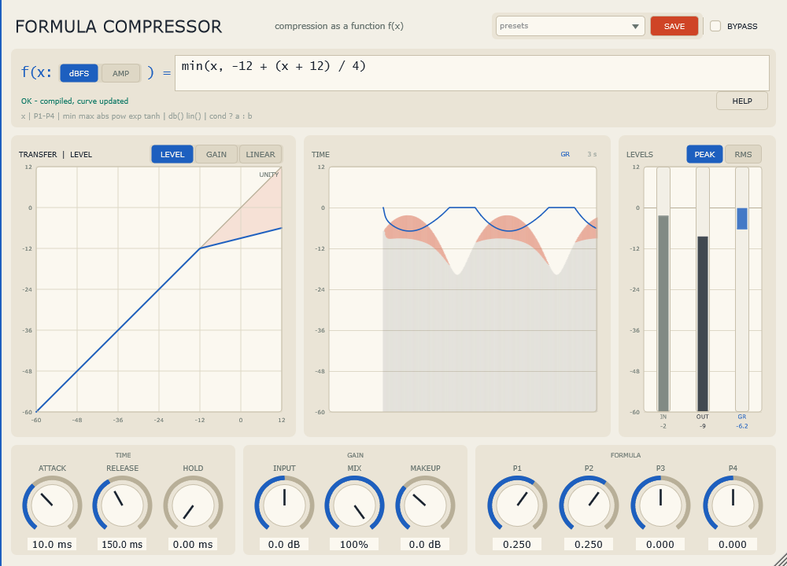

# Formula Compressor（公式压缩器）

**把压缩曲线写成公式。**

传统压缩器的静态传输曲线通常写作 `f(x) = min(x, ax + b)`。Formula Compressor
把这条曲线交给用户：在界面里输入任意表达式 `f(x)`，插件将它作用在检波包络上，
再配合 Attack / Release / Hold 时间参数做动态处理。



## 工作原理

- 立体声联动检波（Peak 或 RMS，RMS 窗口 10 ms）。
- Attack / Release / Hold 平滑检波包络 `e`。
- 公式左侧的 `x:` 开关决定 x 的含义：
  - **AMP**：`x = e`（线性幅度），`f(x)` 返回线性幅度，`gain = f(x)/e`。
  - **dBFS**：`x = 20log10(e)`（dBFS），`f(x)` 返回 dBFS，`gain dB = f(x) - x`。
- 公式描述静态输入/输出曲线，时间参数决定包络如何到达该曲线。
  因此没有波形整形混叠，也没有额外延迟。

AMP 模式下 `f(x)` 的符号承载极性：负输出表示**负增益**，两个声道都会反相
（曲线画成虚线）；`f(x) = 0` 是真正的静音。dBFS 模式是幅度 dB，`f(x) = 0`
表示 0 dB（unity），不是静音；需要静音时写 `-120`。两种模式增益幅度上限都是
+24 dB。Mix 小于 100% 时，反相增益会与干声部分抵消。

默认以 **dBFS** 模式启动，公式是阈值 -12 dBFS、4:1 的经典压缩：

```text
min(x, -12 + (x + 12) / 4)      // x: dBFS
```

公式标题内的 `x:` 开关可在线性幅度（AMP）与 dBFS 之间切换；公式与模式都随
工程状态保存。

## 三种视图

曲线面板可在三种**等刻度**视图之间切换：

| 视图 | 坐标轴 | 含义 |
|---|---|---|
| **LEVEL** | 输入 / 输出电平 dB | 传统压缩传输曲线；`f(x)=x` 是 45° 对角线 |
| **GAIN** | 输入电平 dB / 增益 dB | `f(x)/x`；恒定增益是水平线（`0.2x` = -14 dB），压缩向下倾斜 |
| **LINEAR** | 线性幅度 / 线性幅度 | 普通坐标；斜率就是增益倍数 |

曲线与统一线之间只用两种面积颜色：**teal** 表示增益（>1），**vermilion** 表示
衰减（0 ≤ 增益 < 1）；反相（仅 AMP 模式）改用**虚线曲线**表示，不再使用第三种颜色。

## 时间视图

右侧面板是约 3 秒的滚动电平图，使用与传输图**相同的 dBFS 纵轴**
（网格线在垂直方向对齐）。**仅公式增益后**（不含 Mix / Makeup）的输入/输出电平以
色块面积呈现：

- **石墨灰**：两者公共主体
- **vermilion**：原始独有，即被公式移除的部分
- **teal**：输出独有，即被公式增加的部分
- **cobalt**：同一时间窗内的增益曲线（`f(x)/x`，dB）

电平面积不再描边，仅靠颜色区分。**点击时间图可冻结**传输图、时间图与电平表；
再次点击恢复实时显示。

截图：[LEVEL](Docs/ui-level.png) · [GAIN](Docs/ui-gain.png) ·
[LINEAR](Docs/ui-linear.png) · [反相](Docs/ui-inverted.png) · [dBFS](Docs/ui-dbfs.png)

## 公式语法

`x` 是检波电平，按公式框旁的 `x:` 开关解释为**线性幅度**或**dBFS**。
`P1`–`P4` 是四个可调旋钮（范围 -1..+1）。大小写不敏感，可写 `f(x) = ...`
或 `y = ...` 前缀。

```text
运算    + - * / % ^          ^ 为幂，右结合
比较    < <= > >= == !=      结果为 0 或 1
逻辑    && || !              条件 cond ? a : b
变量    x, P1..P4, pi, e
函数    abs min max clamp(v,lo,hi) pow(a,b) sqrt cbrt
        exp log/ln log10 log2 floor ceil round trunc sign
        sin cos tan asin acos atan atan2 sinh cosh tanh
        step(edge,x) smoothstep(e0,e1,x) mix(a,b,t)
        db(v) lin(d) rand() if(c,a,b)
```

`db(v) = 20*log10(|v|)`，`lin(d) = 10^(d/20)`。语法错误时旧曲线继续运行，
状态行显示错误列号；公式产生非有限值时曲线对应位置标红并被引擎跳过。
增益幅度上限 +24 dB；AMP 模式下负值是反相、零是静音。

示例（AMP）：

```text
min(x, P1 + (x - P1) * P2)                  经典向下压缩
lin(min(db(x), -12 + (db(x) + 12) / 4))     用 dB 书写的同一曲线
x < P1 ? x : P1 + (x - P1) * P2             硬拐点版本
tanh(x * (1 + P1 * 4)) / tanh(1 + P1 * 4)   饱和型曲线
x < P1 ? x * P2 : x                         向下扩展 / 噪声门
-0.5 * x                                    -6 dB 并反相
```

示例（dBFS，x 与 f(x) 都是 dB）：

```text
min(x, -12 + (x + 12) / 4)                  经典 4:1
x < -30 ? x : mix(x, -24 + (x + 24) / 4, smoothstep(-30, -24, x))
x < -36 ? x + 12 : x                        向上压缩
x < -40 ? -120 : x                          -40 dBFS 以下静音
```

## 参数

| 控件 | 范围 | 默认 | 说明 |
|---|---|---|---|
| Attack | 0.1–200 ms | 10 ms | 包络上升 |
| Release | 5–2000 ms | 150 ms | 包络下降 |
| Hold | 0–500 ms | 0 ms | 回落后保持压缩的时间 |
| Mix | 0–100% | 100% | 干湿混合 |
| Input Gain | -24..+24 dB | 0 dB | 检波前输入增益 |
| Makeup | -12..+24 dB | 0 dB | 输出补偿 |
| Detector | Peak / RMS | Peak | RMS 窗口 10 ms |
| P1–P4 | -1..+1 | 0.25, 0.25, 0, 0 | 公式变量 |
| Bypass | 开 / 关 | 关 | 宿主 Bypass 参数 |

公式文本与 `x` 模式随工程状态保存，但不是可自动化参数；其余控件都是标准 VST3
参数。

## 预设

内置（线性）：Classic 4:1、Soft Knee、Hard Limit、Upward Compress、
Expander / Gate、Tanh Comp、Log Comp、Two Stage。
内置（dBFS）：Classic 4:1 (dB)、Soft Knee (dB)、Upward Compress (dB)、Gate (dB)。
加载预设时会同时恢复对应的 `x` 模式。

用户预设保存完整状态到 `%APPDATA%\FormulaCompressor\Presets`，通过顶部的预设菜单
加载，或点 **SAVE** 命名保存。

## 构建与测试

```powershell
# JUCE 解压到 ThirdParty/JUCE-8.0.15（若尚未解压）
cmake -S . -B Build -G "Visual Studio 17 2022" -A x64
cmake --build Build --config Release --target FormulaCompressor_VST3 FormulaCompressor_Standalone FormulaCompressorTests --parallel
.\Build\FormulaCompressorTests_artefacts\Release\FormulaCompressorTests.exe
powershell -ExecutionPolicy Bypass -File Tools\run_pluginval.ps1 -SkipGuiTests
```

- 测试覆盖表达式解析/求值/错误、Attack/Release/Hold 时间、立体声联动、
  Mix/Makeup/Bypass、极端公式、状态与预设往返、多种采样率与块大小。
- `FormulaCompressorTests.exe --screenshot Docs/ui-level.png level|gain|linear ["公式"] [amp|db]`
  无需 DAW 即可渲染指定视图，例如
  `--screenshot Docs/ui-dbfs.png level "min(x, -12 + (x + 12) / 4)" db`。
- 安装 VST3：`powershell -ExecutionPolicy Bypass -File Tools\install_vst3.ps1`
  （加 `-System` 安装到公共目录）。

## 说明

- v1 为立体声联动检波，不含外部侧链。
- 不含 lookahead，延迟为 0，瞬态响应只由 Attack 决定。
- 公式作用于检波增益，而不是逐样本波形整形。
